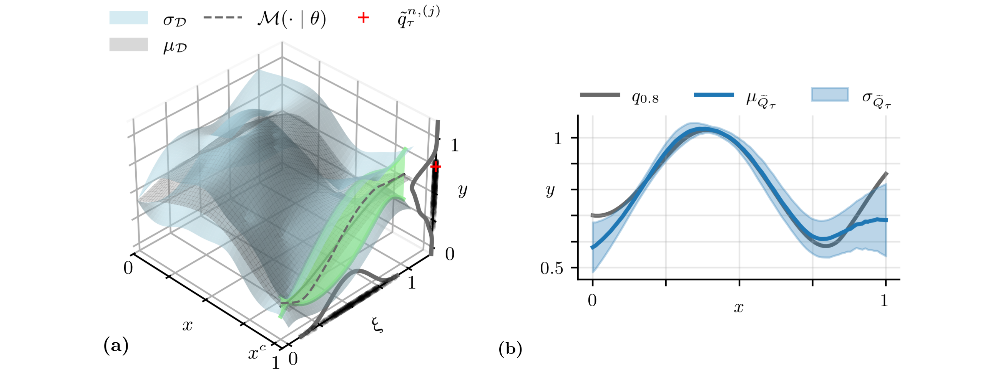

# Efficient Robust Optimization via a Mono-Level Gaussian Process Surrogate
This repository contains the code for the paper "Efficient Robust Optimization via a Mono-Level Gaussian Process Surrogate" by Schultz, Essou and Römer. 

**Abstract** <br>
Optimization under uncertainty seeks designs that perform reliably despite variable or unknown conditions. However, finding an optimal design typically requires solving an optimization problem with a nested uncertainty analysis, resulting in a high computational burden. Surrogate models can alleviate this burden, enabling optimization under uncertainty even with computationally expensive simulation models. <br> 
This paper proposes a novel surrogate-based approach that reduces the number of costly model evaluations needed for training. The approach adopts a mono-level strategy, in which a single Gaussian process surrogate is constructed and adaptively refined for both optimization and uncertainty analysis. <br>
Refinement in the design space is guided by a sampling-based error indicator that propagates the surrogate's epistemic uncertainty to the robustness measure. Efficient error estimation is crucial for scalability of the algorithm and achieved through pathwise sampling combined with a weight-space representation of the Gaussian process. <br>
The proposed approach is evaluated on several analytical benchmarks models and requires fewer model evaluations than a state-of-the-art bi-level surrogate approach while achieving comparable solution accuracy. Once trained the mono-level surrogate can be reused to optimize different robustness measures at reduced cost. Moreover, the approach is successfully applied to a structural optimization problem with constraints and design variable uncertainty. 



## Project structure
```text
repo/
├─ _experiments/RESS            # Optimization results and log files
├─ _reference_comp/             # Reference results for benchmarks
├─ config/                      # Configuration files
│  ├─ paper/
│  ├─ sabater2d.yml
│  ├─ branin_hoo.yml
│  ├─ ...
├─ models/                      # Computational models
│  ├─ bracket.py
│  ├─ library.py
│  ├─ reference.py
├─ notebooks/                   # Visualization 
│  ├─ paper_plots/
├─ ro/                          # Core implementation
│  ├─ acfn.py
│  ├─ convergence.py
│  ├─ helper.py
│  ├─ opt_modules.py
├─ run/                         # High-level running modules
│  ├─ brute_force_reference.py
│  ├─ mono_level_ro.py
├─ scripts/                     # Parameter varition studies
├─ utils/                       # Utility functions
└─ requirements.txt/            # Dependencies
└─ README.md/                   
```

The repositiory is organized in four main folders: 
- **_experiments/RESS**: Optimization results of the paper studies. Raw data inclduing log files, seed runs and plots.
- **reference_comp**: Brute force reference computations for the benchmark models
- **config**: Collects default configuration files for the benchmark models. The subfolder "paper" contains the configs used for the paper studies.
- **models**: Contains a common interface to call any model within the robust optimization algorithm. Benchmark models and the FE bracket model are provided here.
- **notebooks**: Jupyter notebooks to visualize the optimization runs and reproduce the paper plots
- **ro**: Contains the actual implementation of the surrogate-based robust optimization.
- **run**: Contains the high-level python files that can be executed with cmd line arguments
- **scripts**: Scripts to start paper studies

## Getting started

This project can be installed either with **conda** or with **pip**. 
The FEM simulation is based on fenicsx and thus only supported on linux systems.
Optimizations that dont involve fenicsx can also be run on windows. See section 'Running on windows'.

**Create a virtual enironment**

Conda
```bash
conda env create -f environment-linux.yml
conda activate projEnvRO
pip install torch==2.10.0+cu126 --index-url https://download.pytorch.org/whl/cu126
``` 

Pip
```bash
python -m venv .venv
source .venv/bin/activate
pip install -r requirements.txt
pip install torch==2.10.0+cu126 --index-url https://download.pytorch.org/whl/cu126
``` 

**For installation without GPU support call**
```bash
pip install torch==2.10.0 --index-url https://download.pytorch.org/whl/cpu
```

## Run surrogate-based optimization

The general way to run an optimization is
```bash
PATH/TO/PYTHON run/mono_level_ro.py --config config/CONFIG.yaml
```
Check out the configuration parameter in the config file. All these configurations can also be passed as cmd-line args to overwrite the config file. 
We strongly recomment to use 'sampler':'matheron' and 'J_device':'cuda' for computational performance.
Examplarily to optimize the 1D or 2D Sabater test-funtion use:

```bash
PATH/TO/PYTHON run/mono_level_ro.py --config config/sabater1d.yaml --plot_flag   # Saves additional data for plotting
PATH/TO/PYTHON run/mono_level_ro.py --config config/sabater2d.yaml --plot_flag   # Saves additional data for plotting
```

If the acquisition function optimization is very time consuming, consider to reduce the sample sizes defined by the kwargs 'n_samp_gp_opt' and 'n_samp_J_opt'.

### Visualize the results
When running the computation with '--plot_flag' command args additional data for plotting is saved.

To visualize the optimization runs use the notebooks provided in
```bash
notebooks/1D_domain_model.ipynb       # For 1d design domain models
notebooks/2D_domain_model.ipynb       # For 2d design domain models
notebooks/ND_domain_model.ipynb       # For ND design domain models
```
Make sure the notebook file root is the project root folder.

### Reproduce paper plots
The data of the optimization runs for the paper are stored in '_experiments\RESS'. 
To repoduce the paper plots from this data run the notebooks
```bash
notebooks\paper_plots\*
```
Make sure the notebook file root is the project root folder.

## Run scripts
Several shell scripts are provided to automate optimizaiton runs.
To run, first create the file 'scripts/local_env.sh' with the content
```bash
PYTHON_BIN="/path/to/your/python"
```
and then call, e.g.
```bash
bash scripts/paper/sabater_batch_sim.sh
```

### Rerun paper simulations
To rerun the optimization runs of the paper run the scripts in the folder 'scripts/paper', e.g.
```bash
bash scripts/paper/sabater_batch_sim.sh
```

### Compute brute force references
Run the script 
```bash
bash scripts/comp_reference.sh
```
to compute brute force reference results for the analytical benchmark models. Here a genetic optimizer is used for optimization and burte force MC is used for UQ. 

 
## Running on windows

To setup the environment use either

conda
```bash
conda env create -f environment-windows.yml
conda activate projEnvRO
pip install torch==2.10.0+cu126 --index-url https://download.pytorch.org/whl/cu126
``` 

or pip
```bash
python -m venv .venv
.venv\Scripts\Activate.ps1
pip install -r requirements.txt
pip install torch==2.10.0+cu126 --index-url https://download.pytorch.org/whl/cu126
```

To install pytorch without GPU support run
```bash
pip install torch==2.10.0 --index-url https://download.pytorch.org/whl/cpu
```